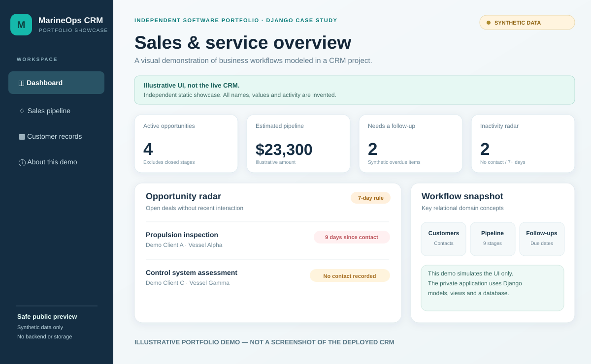

# MarineOps CRM — Safe public UI showcase

**An interactive, standalone portfolio prototype with 100% fictional information.**

> **Important:** The image above is a purpose-made illustration of the **public demo**, not a screenshot of the original private Django CRM or of a live production environment.

## Why this exists

The actual Marine Service CRM project uses Python, Django and relational data models to explore sales, follow-up and technical service workflows. Its code is private. This separate public HTML demo allows a recruiter to understand the product concepts **without** accessing a private codebase, customer names, credentials or databases.

## Explore it locally in under a minute

1. [Open **index.html** in GitHub](./index.html) and choose **Download raw file** (or download this portfolio repository).
2. Save it as \`index.html\` on your computer.
3. Double-click the file to open it in your browser.

There is no installation, build, package manager, backend, account, or environment variable required.

> GitHub's code view displays the **source** of an HTML file; it does not run that page. A shareable web URL requires enabling static hosting (for example GitHub Pages) for this repository. **No live public-demo URL is asserted here.**

## What you can do

- Review dashboard cards for fictional pipeline totals, follow-ups and contact inactivity.
- Explore a pipeline with nine stages.
- Filter fictional opportunities by status or search text.
- Change an opportunity's stage **in browser memory** and see dashboard counts update.
- Reset everything to the original fictional sample records.
- Explore sample customer-to-vessel-to-opportunity relationships.
- Read an explanation of what belongs to the real Django project and what is simulated.

## Safety and limitations

- This is **not the deployed Django app** and does not contain its code, database models, auth logic, internal assets or templates.
- All displayed customers, vessel names, sales amounts and interactions are **invented** for this portfolio.
- The source contains no actual client contacts, credentials, tracking IDs, analytics scripts, fonts or third-party assets.
- No data is transmitted, tracked or saved. Changes are temporary JavaScript state and disappear upon refresh.
- It is a **UI illustration / interaction prototype**, not proof of production reliability or of business impact.
- The project's real tests, permission reviews and safe deployment validation are separate engineering activities.

## Related materials

- [Evidence-based case study (English)](../marine-service-crm.md)
- [Franciel's GitHub profile](https://github.com/Francielb)

---

### Sobre esta demonstração (PT-BR)

Esta é uma **simulação pública do fluxo de um CRM**, criada com HTML, CSS e JavaScript e preenchida com informações fictícias. Ela não reproduz o código privado do sistema em Django. O objetivo é permitir que recrutadores compreendam o conceito do produto sem expor clientes ou dados empresariais.

Para testar, baixe o arquivo \`index.html\` e abra no navegador. As interações não são salvas.
