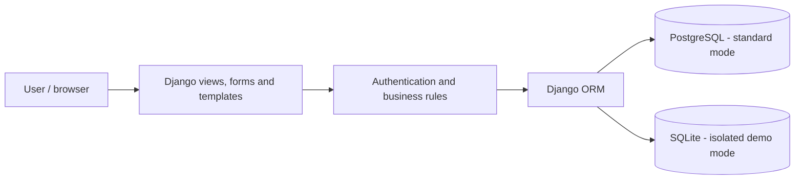
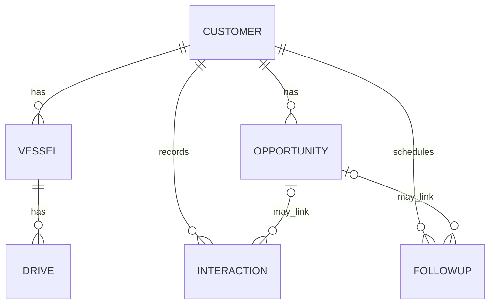

# Marine Service CRM
## Bringing customer relationships, sales follow-ups and technical records into one workflow

**Case study | Python 3.14 · Django 6.1.1 · PostgreSQL · SQLite (demo) · HTML/CSS**

**Type:** Independent software development project, built around a business workflow  
**Stage:** Functional codebase under development; no verified production rollout or business-impact study  
**Source code:** Private. This public case intentionally excludes customer details, credentials and proprietary assets.

> **In 30 seconds:** A server-rendered Django CRM that models customers, commercial opportunities, interactions, scheduled follow-ups and equipment service history. It connects a sales pipeline to practical operational records, showing how business understanding can inform database design and application features.

## Public UI demonstration (fictional data only)

**[Launch the static interactive showcase](https://franciel-marine-crm-showcase.vercel.app)** · [View HTML source](./crm-demo/index.html) · **[How to open and explore the demo](./crm-demo/README.md)**

This is a **separate, browser-only HTML/CSS/JavaScript simulation**, not the actual Django app. Its sample customer names, vessels and values are invented. It makes no external requests and does not store data. The SVG is a conceptual preview of the simulation, **not an authentic screenshot of the private CRM**.

### Test evidence and status

A focused suite of **21 Django regression tests** covering business models, opportunity changes, follow-ups, dashboard calculations and utility functions **passed in GitHub Actions on a private proposed-change branch** (20 October 2026). This verifies those checks only; it does not establish production security, browser-level correctness or client adoption. Deployment changes are being reviewed separately, and this portfolio page does not claim a new live production release.

## 1. The business problem

Sales and technical-service workflows require different kinds of information: who the customer is, what has been discussed, which opportunities need attention, and what equipment is associated with each request.

When these pieces of information are managed separately, it becomes harder to maintain context and prioritize follow-ups. This project explores a **single application workflow** for relating them. That is the product problem the prototype addresses—not a claim that a customer organization has already measured the benefit.

## 2. The solution

The application brings several activities together:

- **Customer records:** contact information, acquisition source and linked records.
- **Technical context:** vessels and associated propulsion/engine details.
- **Sales pipeline:** opportunities with estimated values and nine defined status stages.
- **Activity history:** customer interactions and notes associated with opportunities.
- **Follow-up management:** scheduled actions, due dates and completion status.
- **Operational overview:** dashboard totals, overdue follow-ups, pipeline value and an inactivity radar based on a seven-day threshold.
- **Demonstration workflow:** an isolated SQLite configuration with synthetic records.

These are features evidenced by the project structure, Django models, views and management commands. They have **not** been described as independently benchmarked or production-validated.

## 3. Technology stack

| Layer | Technology | Evidence and purpose |
| --- | --- | --- |
| Language | **Python 3.14** | Version specified in the repository's Python version file |
| Web framework | **Django 6.1.1** | Pinned dependency; views, forms, templates, authentication and ORM |
| Relational database | **PostgreSQL** | Configured for the standard database environment |
| Database adapter | **psycopg 3.3.6** | PostgreSQL connectivity, pinned dependency |
| Demo database | **SQLite** | Isolated demo mode with synthetic records |
| User interface | **Django Templates, HTML, CSS** | Server-rendered web application |
| Data modeling | **Django ORM and migrations** | Relationships between commercial and technical entities |

**Skill focus:** Python · Django · SQL/relational modeling · Web development · CRM workflows · Applied business analysis.

## 4. How the pieces connect

The source defines **six business models**. Their main relationships can be summarized as:

This structure keeps customer data connected to the sales process and related technical records. Some associations are optional, allowing entries to exist without an opportunity link.

## 5. Engineering choices and trade-offs

**Django and server-rendered pages.** A framework with built-in authentication, ORM, forms and templating reduces the amount of infrastructure needed for an early business application. The trade-off is a tightly coupled server-rendered architecture rather than a separate API and frontend.

**PostgreSQL for the standard environment.** It is suitable for relational data and structured queries. An SQLite-based demo mode keeps example data separate from normal database credentials; it is not a substitute for a production access-control review.

**Explicit relationships and statuses.** The schema links customers, equipment, opportunities, interactions and follow-ups. A nine-stage opportunity pipeline makes operational state explicit and queryable.

**Commercial signals in the dashboard.** The dashboard uses database queries to calculate totals and detect opportunities lacking recent interaction. Its seven-day inactivity rule is a project-defined threshold, **not** evidence of improved conversion rates.

## 6. Evidence vs. outcomes

| What can be verified from the codebase | What has not been established |
| --- | --- |
| Six Django business-domain models | Real-world reduction in follow-up time |
| Nine defined opportunity statuses | Revenue or conversion improvement |
| Dashboard queries and seven-day inactivity logic | Production scale or load-test capacity |
| Follow-up, interaction and technical-record views | Completed security assessment |
| A command for generating synthetic demo records | A comprehensive automated test suite |

**There are no invented performance numbers in this case study.** The strongest available evidence is implemented functionality and documented technical decisions.

## 7. Current limitations and next steps

1. Add tests for model relationships, permissions, forms and main user flows. The current test module is only a starter file.
2. Review authorization boundaries, demo session behavior and security settings before any public deployment.
3. Build repeatable CI checks and verify setup instructions on a clean environment.
4. Prepare sanitized screenshots or a read-only demo using exclusively fake data.
5. Record performance and usability measurements only after repeatable testing.

### Can I run or review the code?

The repository is **private**, so this page is a public technical case study rather than an open-source release. There is no public demo URL endorsed by this document. Code visibility and interactive demos can be revisited after sensitive material is removed and deployment behavior is validated.

## 8. Why this project matters to my career

I'm transitioning from **B2B digital marketing and business operations into software development**. The experience of working with commercial processes helped me identify a concrete problem to model in Python and Django.

This project demonstrates the connection I'm building between **business context, relational data and software implementation**—and it also highlights the technical areas I am still improving.

**Author:** [Franciel Gustavo Bresolin](https://github.com/Francielb)

---

### Resumo em português

Projeto independente de CRM em Python/Django para conectar **clientes, oportunidades comerciais, acompanhamentos e histórico técnico** em uma mesma aplicação. O código inclui seis modelos de negócio, funil com nove etapas e demonstração com dados fictícios. A implementação segue em desenvolvimento, sem métricas de impacto comercial comprovadas. O repositório de código permanece privado para preservar dados e materiais de terceiros.
